<div class="portada">

# Universidad del Desarrollo
## Escuela de Ingeniería

### Redes de Computadores

# Examen Final Integrador
## Diseño, implementación y continuidad de la red corporativa de ApexLogística SpA

**Estudiante:** [COMPLETAR]
**RUT:** [COMPLETAR]
**Docente:** Ricardo Bravo
**Fecha:** 25 de noviembre de 2026

**Estado del documento:** BORRADOR (la Parte 2 – dominio en AWS – está pendiente)

</div>

---

## Índice

1. Introducción
2. Diseño de la topología y tabla VLSM
3. Enrutamiento estático y dinámico
4. Configuración de SSH y seguridad básica
5. Diseño e implementación del dominio **[PENDIENTE – PARTE 2 EN AWS]**
6. Políticas aplicadas y justificación **[PENDIENTE – PARTE 2 EN AWS]**
7. DNS y sitio web
8. Pruebas y plan de continuidad
9. Problemas encontrados y soluciones
10. Análisis de resultados y conclusiones técnicas
11. Referencias

---

## 1. Introducción

ApexLogística SpA es una empresa de transporte y distribución con tres sedes: Santiago (casa matriz), Valparaíso y Concepción. Necesita una red corporativa que comunique las sedes entre sí y con Internet, que resista la caída de un enlace, que se administre de forma remota y segura, y que publique servicios internos de nombres (DNS) y web.

Este informe documenta el diseño y la implementación de esa red en Cisco Packet Tracer:

- direccionamiento VLSM sobre el bloque privado 172.16.40.0/22;
- enrutamiento mixto: OSPF dentro de la empresa y rutas estáticas, con rutas flotantes de respaldo, hacia Internet;
- endurecimiento básico de los routers con acceso exclusivo por SSH versión 2;
- servicios DNS y HTTP en un servidor central;
- un plan de continuidad validado con una prueba real de falla de enlace.

Todas las configuraciones se verificaron leyendo el estado real de los equipos. Las salidas de comandos quedaron como archivos de texto en la carpeta `evidencias/` y las capturas se insertan en cada sección.

La implementación del dominio (Active Directory / Samba en máquinas virtuales de AWS) corresponde a la Parte 2 y se documentará en una versión posterior de este informe.

---

## 2. Diseño de la topología y tabla VLSM

### 2.1 Topología

La red tiene cuatro routers Cisco 2911: **ISP** (simula el proveedor y "Internet" con la interfaz Loopback0 8.8.8.8/32), **R-Santiago**, **R-Valparaiso** y **R-Concepcion**.

- Cada sede se conecta al ISP con un enlace /30 propio.
- Hay dos enlaces entre sucursales: Santiago–Valparaíso (serial) y Valparaíso–Concepción (Gigabit). No existe un enlace directo Santiago–Concepción.
- Cada sede tiene un switch 2960 y dos PCs.
- Santiago tiene además una red de servidores con su propio switch, el servidor **SRV-Principal** (DNS y Web) y la PC de gestión **ADMIN**.

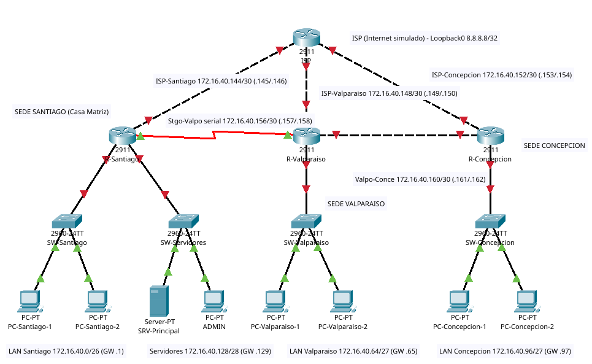

*Figura 1. Topología implementada (E1_01). Las notas del canvas identifican cada sede, la red de cada LAN y la de cada enlace /30.*

**Justificación del hardware.** El Cisco 2911 trae tres interfaces GigabitEthernet integradas y ranuras EHWIC para ampliarlo. R-Santiago necesita cuatro interfaces (ISP, LAN, servidores y Valparaíso) y R-Valparaiso también (ISP, LAN, Santiago y Concepción). Por eso se les instaló una tarjeta **HWIC-2T**, que añade dos puertos seriales, y el enlace Santiago–Valparaíso se implementó como serial punto a punto. R-Santiago es el extremo DCE, con `clock rate 64000`, verificado con `show controllers`. R-Concepcion y el ISP caben en las tres interfaces integradas. Entre routers se usó cable cruzado y entre router, switch y hosts cable directo.

Evidencias: `E1_01_topologia_dispositivos_y_enlaces.txt`, `E2_02_show_controllers_serial.txt`.

### 2.2 Cálculo VLSM

Se asignó el bloque **172.16.40.0/22** (1024 direcciones). Con VLSM, las subredes se asignan **de mayor a menor** cantidad de hosts y cada una recibe el menor prefijo que cubre su demanda, según la fórmula hosts útiles = 2^h − 2, donde *h* es el número de bits de host.

| Orden | Subred | Hosts pedidos | Bits de host | Hosts disponibles | Prefijo |
|---|---|---|---|---|---|
| 1 | LAN Santiago | 60 | 6 | 62 | /26 |
| 2 | LAN Valparaíso | 30 | 5 | 30 | /27 |
| 3 | LAN Concepción | 20 | 5 | 30 | /27 |
| 4 | Servidores / Mgmt | 10 | 4 | 14 | /28 |
| 5–9 | Enlaces punto a punto (×5) | 2 | 2 | 2 | /30 |

### 2.3 Tabla de direccionamiento

| Subred | Red / prefijo | Máscara | Rango usable | Gateway / extremos | Broadcast |
|---|---|---|---|---|---|
| LAN Santiago | 172.16.40.0/26 | 255.255.255.192 | .1 – .62 | .1 (R-Santiago Gi0/1) | .63 |
| LAN Valparaíso | 172.16.40.64/27 | 255.255.255.224 | .65 – .94 | .65 (R-Valparaiso Gi0/1) | .95 |
| LAN Concepción | 172.16.40.96/27 | 255.255.255.224 | .97 – .126 | .97 (R-Concepcion Gi0/1) | .127 |
| Servidores / Mgmt | 172.16.40.128/28 | 255.255.255.240 | .129 – .142 | .129 (R-Santiago Gi0/2) | .143 |
| ISP – Santiago | 172.16.40.144/30 | 255.255.255.252 | .145 – .146 | ISP .145 / R-Santiago .146 | .147 |
| ISP – Valparaíso | 172.16.40.148/30 | 255.255.255.252 | .149 – .150 | ISP .149 / R-Valparaiso .150 | .151 |
| ISP – Concepción | 172.16.40.152/30 | 255.255.255.252 | .153 – .154 | ISP .153 / R-Concepcion .154 | .155 |
| Santiago – Valparaíso | 172.16.40.156/30 | 255.255.255.252 | .157 – .158 | R-Santiago .157 / R-Valparaiso .158 | .159 |
| Valparaíso – Concepción | 172.16.40.160/30 | 255.255.255.252 | .161 – .162 | R-Valparaiso .161 / R-Concepcion .162 | .163 |
| **Libre (crecimiento)** | 172.16.40.164 – 172.16.43.255 | – | – | – | – |

| Equipo | IP | Gateway | DNS |
|---|---|---|---|
| PC-Santiago-1 / -2 | 172.16.40.2 / .3 | 172.16.40.1 | 172.16.40.130 |
| PC-Valparaiso-1 / -2 | 172.16.40.66 / .67 | 172.16.40.65 | 172.16.40.130 |
| PC-Concepcion-1 / -2 | 172.16.40.98 / .99 | 172.16.40.97 | 172.16.40.130 |
| SRV-Principal (DNS + Web) | 172.16.40.130 | 172.16.40.129 | 172.16.40.130 |
| ADMIN (gestión) | 172.16.40.131 | 172.16.40.129 | 172.16.40.130 |
| **Domain Controller (reservado, Parte 2)** | **172.16.40.132** | 172.16.40.129 | – |

El diseño usa 164 de las 1024 direcciones del bloque (≈ 16 %). La LAN de Valparaíso (/27) queda **justo en 30 hosts**. Si la sede crece, se migrará a un /26 tomado del espacio libre (por ejemplo 172.16.40.192/26) o se agregará una segunda subred anunciada por OSPF. Como las subredes se asignaron de mayor a menor, el espacio libre queda contiguo y ese crecimiento no obliga a renumerar las otras sedes.

Detalle completo: `evidencias/tabla_vlsm.md`. Verificación de interfaces: `E2_01_show_ip_interface_brief_routers.txt`; hosts: `E2_03_hosts_ipconfig_y_ping_gateway.txt`.

---

## 3. Enrutamiento estático y dinámico

### 3.1 Diseño

| Mecanismo | Configuración | Propósito |
|---|---|---|
| **OSPFv2**, proceso 1, área 0 | Router-ID fijos: ISP 1.1.1.1, R-Santiago 2.2.2.2, R-Valparaiso 3.3.3.3, R-Concepcion 4.4.4.4. Un `network` con wildcard por cada red conectada. | Aprender y mantener automáticamente todas las redes internas; reconvergencia ante fallas. |
| `passive-interface` | Interfaces LAN y de servidores (Gi0/1, y además Gi0/2 en Santiago) | Anunciar esas redes sin enviar *hellos* OSPF hacia los usuarios, lo que ahorra tráfico y evita adyacencias no autorizadas. |
| `ip ospf cost 100` | En los dos extremos de los tres enlaces con el ISP | Que el tráfico **entre sedes** use los enlaces inter-sucursales y no pase por el ISP. |
| Ruta estática por defecto | `ip route 0.0.0.0 0.0.0.0 <ISP>` (AD 1) en cada sucursal | Salida a Internet por el ISP propio de cada sede. |
| Ruta **flotante** de respaldo | `ip route 0.0.0.0 0.0.0.0 <vecino inter-sucursal> 210` | Salida alternativa si cae el enlace con el ISP. |
| Resumen en el ISP | `ip route 172.16.40.0 255.255.252.0 172.16.40.146 250` | Último respaldo del ISP hacia la empresa si OSPF dejara de anunciar alguna red. |

**Por qué se combinan.** OSPF resuelve el problema interno: conoce la topología completa y recalcula los caminos solo cuando cambia un enlace. Las rutas estáticas controlan de forma explícita y predecible la salida hacia un proveedor externo. En una red real, el proveedor no participa del OSPF de la empresa.

La Loopback 8.8.8.8 del ISP **no se anuncia** por OSPF. Representa Internet, por lo que se alcanza mediante la ruta por defecto. Si se anunciara, aparecería como ruta `O`, más específica, y la ruta estática por defecto no se usaría.

**Cálculo de costos** (ancho de banda de referencia de 100 Mbps: GigabitEthernet = 1, serial 1544 kbps = 64):
- Santiago → LAN Concepción por los enlaces inter-sucursales: 64 + 1 + 1 = **66**.
- El mismo destino por el ISP: 100 + 100 + 1 = **201**.

OSPF elige el camino inter-sucursal.

### 3.2 Comandos relevantes (R-Santiago)

```
router ospf 1
 router-id 2.2.2.2
 network 172.16.40.0 0.0.0.63 area 0
 network 172.16.40.128 0.0.0.15 area 0
 network 172.16.40.144 0.0.0.3 area 0
 network 172.16.40.156 0.0.0.3 area 0
 passive-interface GigabitEthernet0/1
 passive-interface GigabitEthernet0/2
interface GigabitEthernet0/0
 ip ospf cost 100
ip route 0.0.0.0 0.0.0.0 172.16.40.145
ip route 0.0.0.0 0.0.0.0 172.16.40.158 210
```

La configuración de los cuatro routers está en `E4_01_configuracion_enrutamiento.txt`.

### 3.3 Evidencia de adyacencias y tablas de rutas

Las cinco adyacencias OSPF (ISP–Santiago, ISP–Valparaíso, ISP–Concepción, Santiago–Valparaíso y Valparaíso–Concepción) están en estado **FULL**.

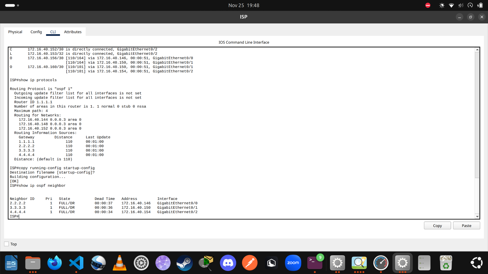

*Figura 2. `show ip ospf neighbor` en el ISP (E4_01): tres vecinos en FULL, uno por sucursal, con Router-ID 2.2.2.2, 3.3.3.3 y 4.4.4.4.*

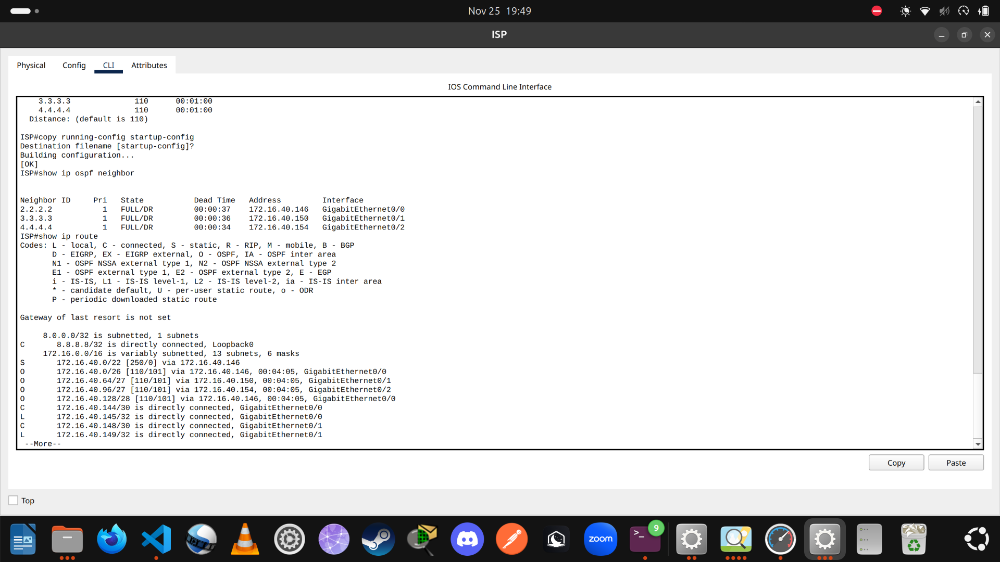

*Figura 3. `show ip route` en el ISP (E4_02). Las LAN se aprenden por OSPF (`O`) y conviven con la ruta resumida estática 172.16.40.0/22 con AD 250, que solo se usaría si OSPF dejara de anunciarlas, porque siempre gana el prefijo más específico.*

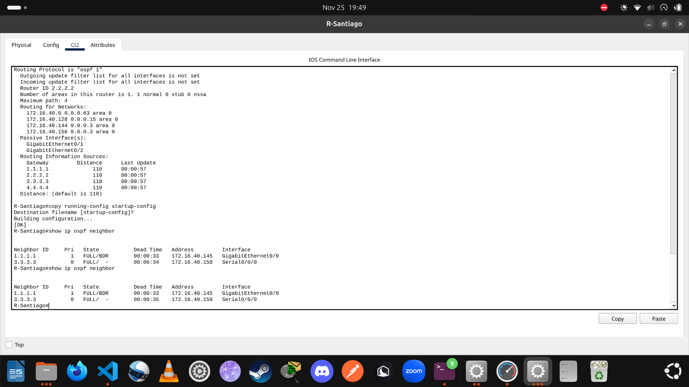

*Figura 4. Vecinos de R-Santiago (E4_03): el ISP por Gi0/0 (FULL/BDR) y R-Valparaiso por Serial0/0/0 (`FULL/ -`). En un enlace punto a punto no se elige DR/BDR.*

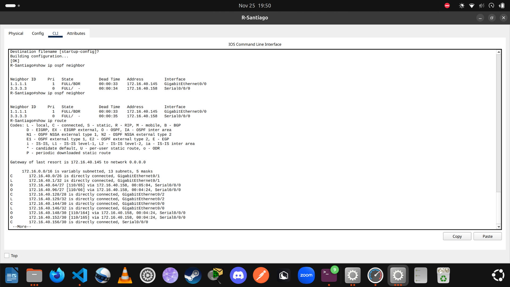

*Figura 5. Tabla de rutas de R-Santiago (E4_04). Las LAN de Valparaíso (costo 65) y de Concepción (costo 66) se alcanzan por el serial, no por el ISP, y el Gateway of last resort es 172.16.40.145 (ISP).*

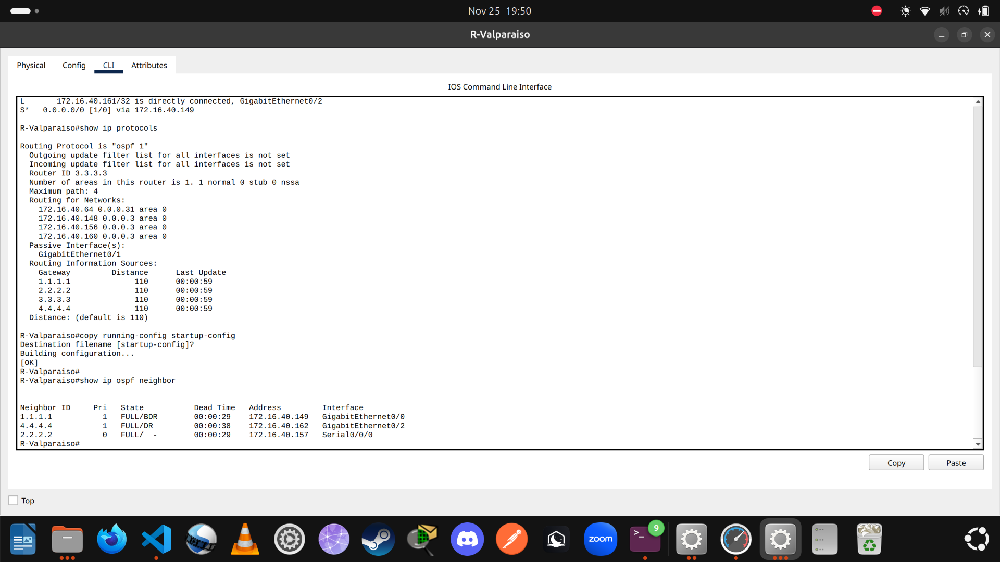

*Figura 6. R-Valparaiso tiene tres vecinos FULL (E4_05). Es el nodo de tránsito entre Santiago y Concepción, y su ruta por defecto S\* apunta a 172.16.40.149.*

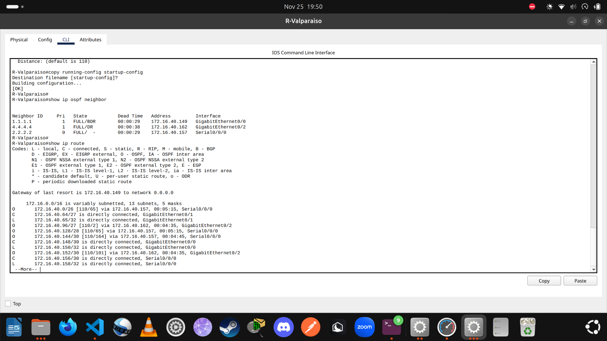

*Figura 7. Tabla de rutas de R-Valparaiso (E4_06). La LAN de Concepción tiene costo 2 por el enlace Gigabit directo.*

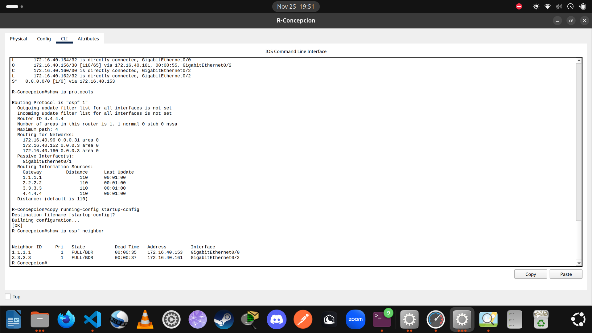

*Figura 8. R-Concepcion con sus vecinos ISP y R-Valparaiso en FULL (E4_07), y la ruta por defecto S\* hacia 172.16.40.153.*

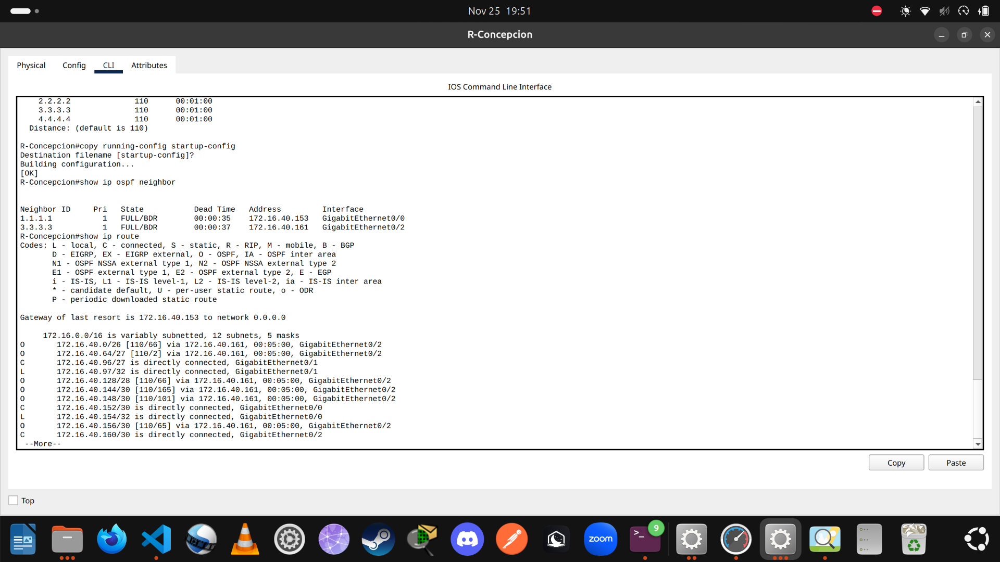

*Figura 9. Tabla de rutas de R-Concepcion (E4_08). Todas las redes internas se alcanzan por Valparaíso (172.16.40.161).*

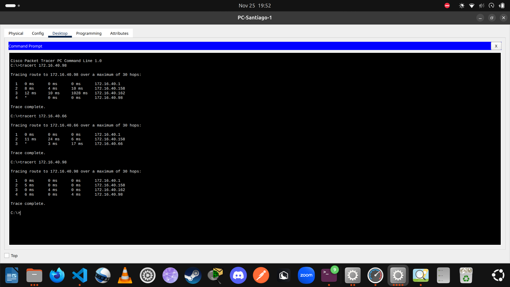

*Figura 10. `tracert` de PC-Santiago-1 a PC-Concepcion-1 (E4_09). El camino es .1 → .158 (Valparaíso) → .162 (Concepción). Esto confirma que el costo 100 en los enlaces del ISP hace que el tráfico entre sedes use los enlaces inter-sucursales.*

Salidas completas: `E4_02_show_ip_ospf_neighbor_4_routers.txt`, `E4_03_show_ip_route_4_routers.txt`, `E4_04_show_ip_protocols_4_routers.txt`, `E4_05_tracert_caminos_inter_sucursales.txt`.

---

## 4. Configuración de SSH y seguridad básica

Se aplicó la misma configuración en los cuatro routers. Las contraseñas se muestran como \*\*\*\*:

```
hostname R-Santiago
no ip domain-lookup
banner motd # ACCESO RESTRINGIDO: Solo personal autorizado - ApexLogistica SpA. Todo acceso es monitoreado y registrado. #
enable secret ****
service password-encryption
username admin privilege 15 secret ****
ip domain-name apexlogistica.local
crypto key generate rsa general-keys modulus 1024
ip ssh version 2
line console 0
 login local
 exec-timeout 5 0
line vty 0 4
 login local
 transport input ssh
 exec-timeout 5 0
```

| Medida | Justificación |
|---|---|
| `enable secret` y `username … secret` | La contraseña se guarda como hash (tipo 5) y no como texto plano. |
| `service password-encryption` | Ofusca cualquier otra contraseña de tipo 7 que quede en la configuración. |
| `banner motd` | Aviso legal de acceso restringido antes de autenticarse. |
| `ip domain-name` + RSA de 1024 bits | Requisitos para generar las llaves que usa SSH. |
| `ip ssh version 2` | Desactiva SSHv1, que tiene vulnerabilidades conocidas. |
| `transport input ssh` | Las líneas VTY solo aceptan SSH, así que Telnet (texto plano) queda bloqueado. |
| `login local` en consola y VTY | Exige usuario y contraseña individuales, lo que permite saber quién se conectó. |
| `exec-timeout 5 0` | Cierra las sesiones inactivas a los 5 minutos. |

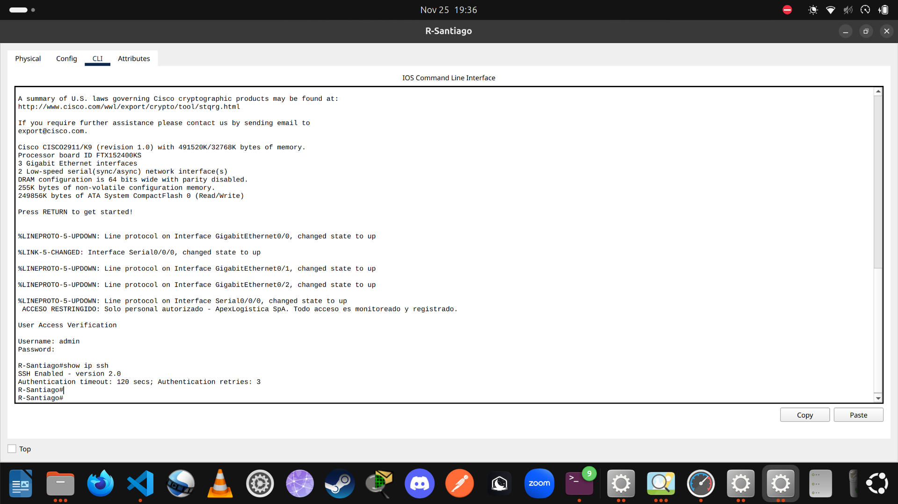

*Figura 11. Consola de R-Santiago (E3_01): aparece el banner, se pide usuario y contraseña (`login local`) y `show ip ssh` confirma "SSH Enabled - version 2.0".*

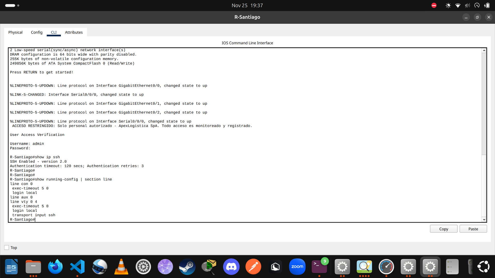

*Figura 12. `show running-config | section line` (E3_02): consola y VTY con `login local` y `exec-timeout 5 0`, y VTY con `transport input ssh`.*

Verificación en los cuatro routers: `E3_02_show_ip_ssh_y_lineas_4_routers.txt`. Las pruebas de acceso remoto están en la sección 8.2.

---

## 5. Diseño e implementación del dominio

> **[PENDIENTE – PARTE 2 EN AWS]**

### 5.1 Arquitectura del dominio
*(nombre del dominio, rol del controlador, IP reservada 172.16.40.132, relación con el DNS)*

### 5.2 Implementación en AWS
*(instancias EC2, sistema operativo, grupos de seguridad, red/VPC)*

### 5.3 Instalación y promoción del controlador de dominio
*(Active Directory Domain Services o Samba AD DC)*

### 5.4 Unión de equipos cliente al dominio

### 5.5 Unidades organizativas, usuarios y grupos

**Capturas esperadas:**
- E7_01: instancias EC2 en ejecución (consola AWS)
- E7_02: grupos de seguridad / reglas de entrada
- E7_03: rol AD DS / Samba instalado y dominio creado
- E7_04: cliente unido al dominio
- E7_05: estructura de OU, usuarios y grupos
- E7_06: inicio de sesión con una cuenta del dominio

---

## 6. Políticas aplicadas y justificación

> **[PENDIENTE – PARTE 2 EN AWS]**

### 6.1 Política de contraseñas y bloqueo de cuenta
### 6.2 Políticas de seguridad del escritorio (GPO)
### 6.3 Permisos y principio de mínimo privilegio
### 6.4 Justificación de cada política

**Capturas esperadas:**
- E8_01: editor de GPO con la política de contraseñas
- E8_02: política de bloqueo de cuenta
- E8_03: GPO adicional aplicada (por ejemplo, bloqueo de pantalla o restricción de panel de control)
- E8_04: `gpresult /r` en un cliente mostrando las GPO aplicadas
- E8_05: prueba del efecto de la política en el cliente

---

## 7. DNS y sitio web

### 7.1 DNS

En SRV-Principal (172.16.40.130) se activó el servicio DNS con dos registros A:

| Nombre | Tipo | Valor |
|---|---|---|
| www.apexlogistica.local | A | 172.16.40.130 |
| srv.apexlogistica.local | A | 172.16.40.130 |

Todos los equipos usan 172.16.40.130 como servidor DNS. Cuando un usuario escribe `http://www.apexlogistica.local`, el PC consulta al DNS, recibe la IP 172.16.40.130, abre una conexión TCP al puerto 80 de esa IP y pide la página con HTTP GET. Desde Valparaíso y Concepción, la consulta y la página viajan por los enlaces inter-sucursales gracias a OSPF.

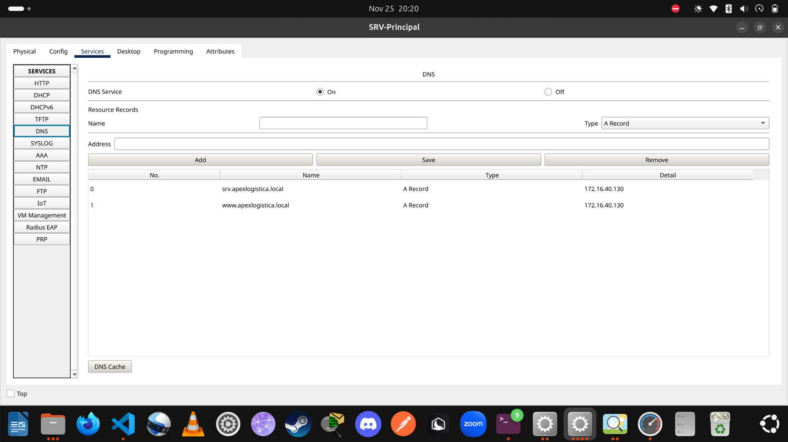

*Figura 13. Servicio DNS de SRV-Principal (E5_07): servicio activado (On) y los registros A `www` y `srv` apuntando a 172.16.40.130.*

`nslookup` resolvió correctamente desde las tres sedes (`E5_01_dns_registros_y_nslookup.txt`).

### 7.2 Sitio web

Se reemplazó la página por defecto del servidor por dos páginas propias (la fuente está en la carpeta `web/`):

- **index.html:** presentación de ApexLogística SpA (quiénes somos, sedes, servicios y enlace a la documentación).
- **documentacion.html:** "Documentación Técnica / Investigación", con el diseño de red y la tabla VLSM; la combinación de enrutamiento estático y OSPF; SSH y seguridad básica; la importancia de la administración centralizada de usuarios (Active Directory / Samba, GPO); el resumen del plan de continuidad, y referencias en formato APA 7.

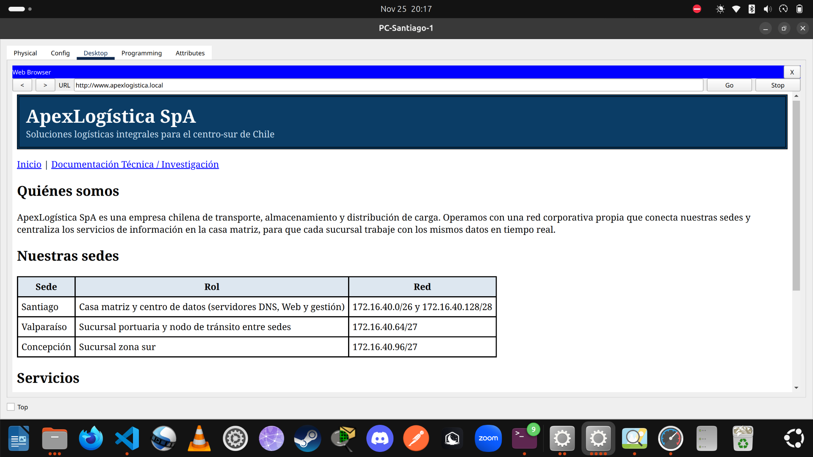

*Figura 14. Página de inicio cargada por nombre desde PC-Santiago-1 (E5_01).*

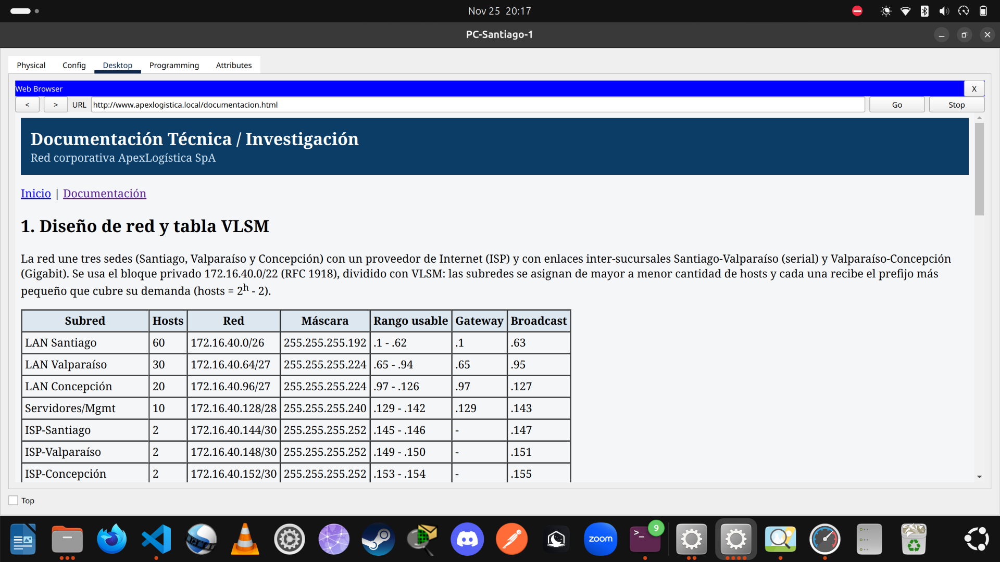

*Figura 15. Página de documentación técnica desde PC-Santiago-1 (E5_02), con la tabla VLSM.*

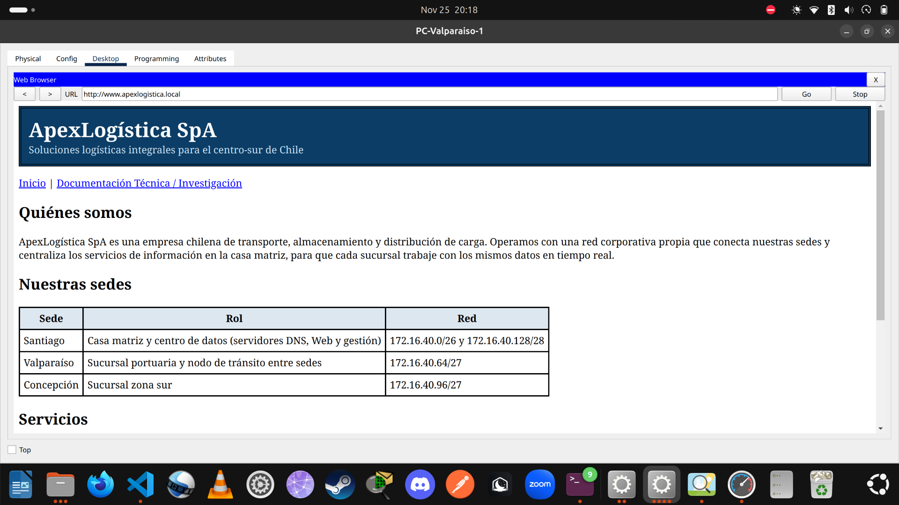

*Figura 16. Página de inicio desde PC-Valparaiso-1 (E5_03): el acceso remoto atraviesa el enlace serial Santiago–Valparaíso.*

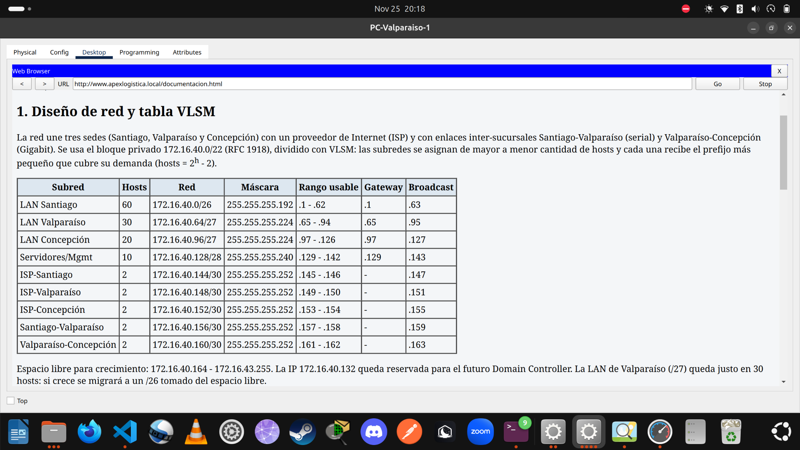

*Figura 17. Documentación técnica desde PC-Valparaiso-1 (E5_04).*


*Figura 18. Página de inicio desde PC-Concepcion-1 (E5_05): el tráfico recorre Concepción → Valparaíso → Santiago.*

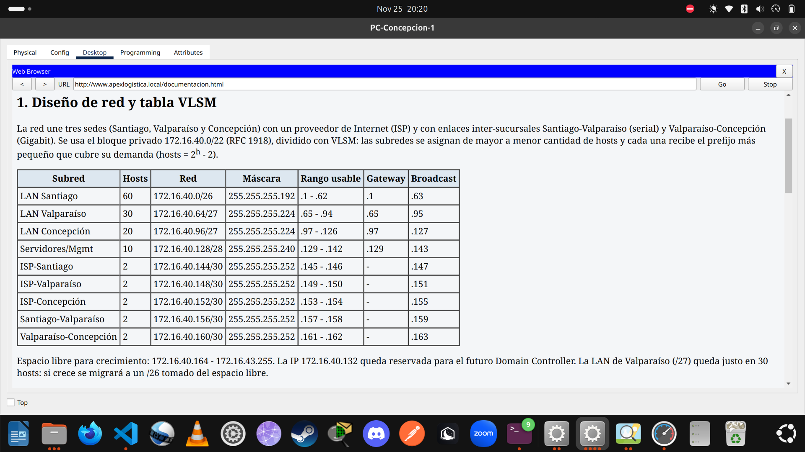

*Figura 19. Documentación técnica desde PC-Concepcion-1 (E5_06).*

Resumen de pruebas: `E5_02_http_paginas_y_navegador_3_sedes.txt`.

---

## 8. Pruebas y plan de continuidad

### 8.1 Conectividad

| Origen \ Destino | Santiago | Valparaíso | Concepción | Internet (8.8.8.8) | SRV-Principal |
|---|---|---|---|---|---|
| PC-Santiago-1 | – | ✔ 0 % pérdida | ✔ 0 % | ✔ 0 % | ✔ 0 % |
| PC-Valparaiso-1 | ✔ 0 % | – | ✔ 0 % | ✔ 0 % | ✔ 0 % |
| PC-Concepcion-1 | ✔ 0 % | ✔ 0 % | – | ✔ 0 % | ✔ 0 % |

Las 12 pruebas de ping fueron exitosas. Los tracert confirman tres cosas:
- Santiago ↔ Concepción transita por Valparaíso.
- Cada sede sale a Internet por su propio ISP, en 2 saltos.
- El tráfico hacia SRV-Principal usa los enlaces inter-sucursales.

Evidencias: `E6_01_ping_matriz_conectividad.txt` y `E6_02_tracert_matriz_conectividad.txt`.

### 8.2 Soporte remoto por SSH

| Origen | Destino | Resultado |
|---|---|---|
| PC-Valparaiso-1 y PC-Valparaiso-2 | R-Santiago (172.16.40.1) | ✔ |
| PC-Concepcion-1 | R-Valparaiso (172.16.40.65) | ✔ |
| ADMIN | ISP (172.16.40.145) | ✔ |
| ADMIN | R-Santiago (172.16.40.129) | ✔ |
| ADMIN | R-Valparaiso (172.16.40.65) | ✔ |
| ADMIN | R-Concepcion (172.16.40.97) | ✔ |
| ADMIN | Telnet a R-Santiago | ✖ rechazado (esperado) |

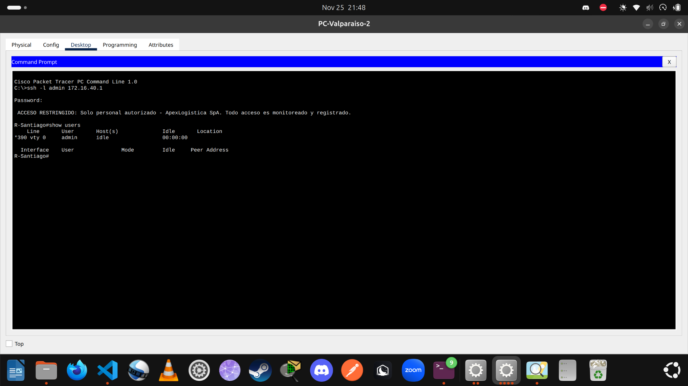

*Figura 20. SSH desde PC-Valparaiso-2 a R-Santiago (E6_01): desde `C:\>` se abre la sesión, aparece el banner y `show users` confirma la sesión remota de `admin` en `vty 0`.*

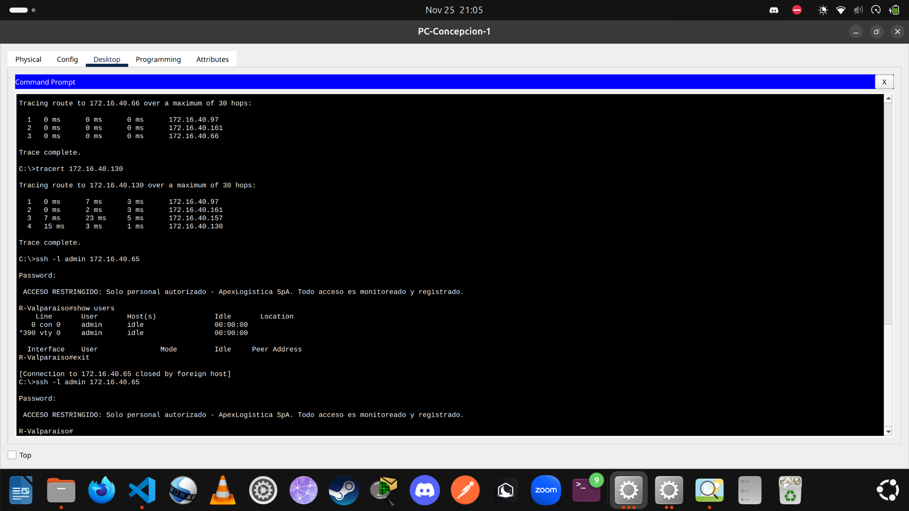

*Figura 21. SSH desde PC-Concepcion-1 a R-Valparaiso (E6_02): `show users` muestra la consola local y la sesión remota por VTY.*

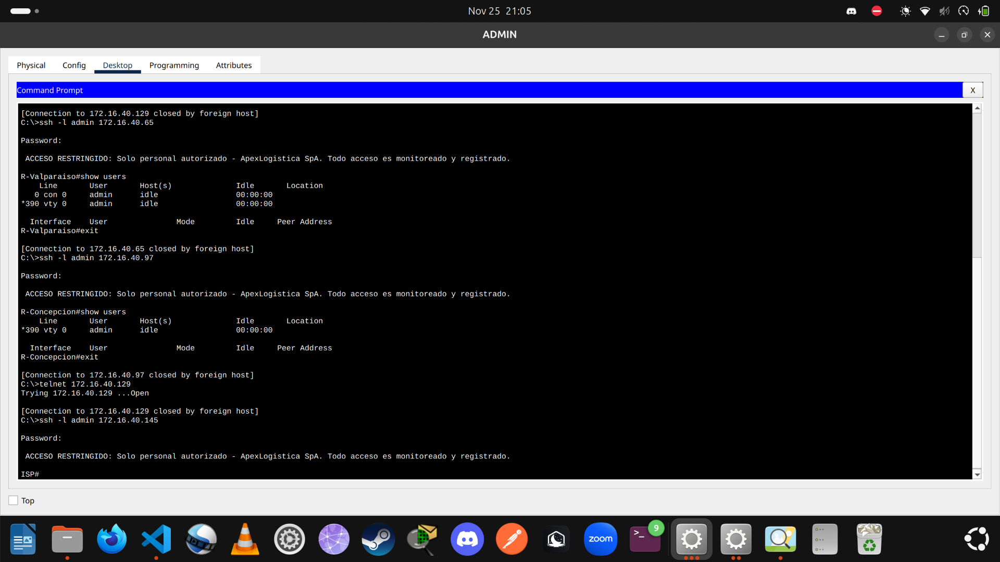

*Figura 22. ADMIN → ISP (E6_03). En la misma pantalla se ve la prueba de Telnet rechazada: la conexión TCP abre, pero el router la cierra sin pedir credenciales.*

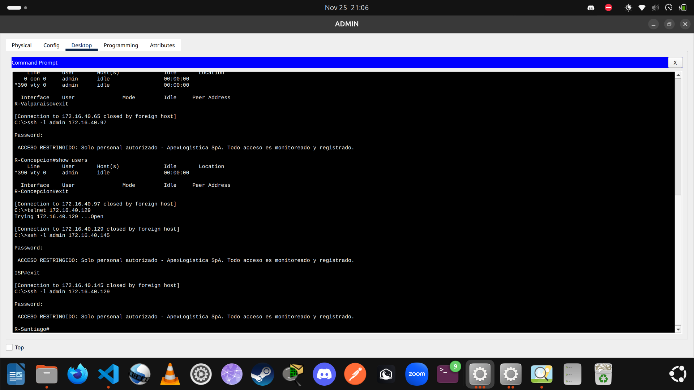

*Figura 23. ADMIN → R-Santiago (E6_04).*

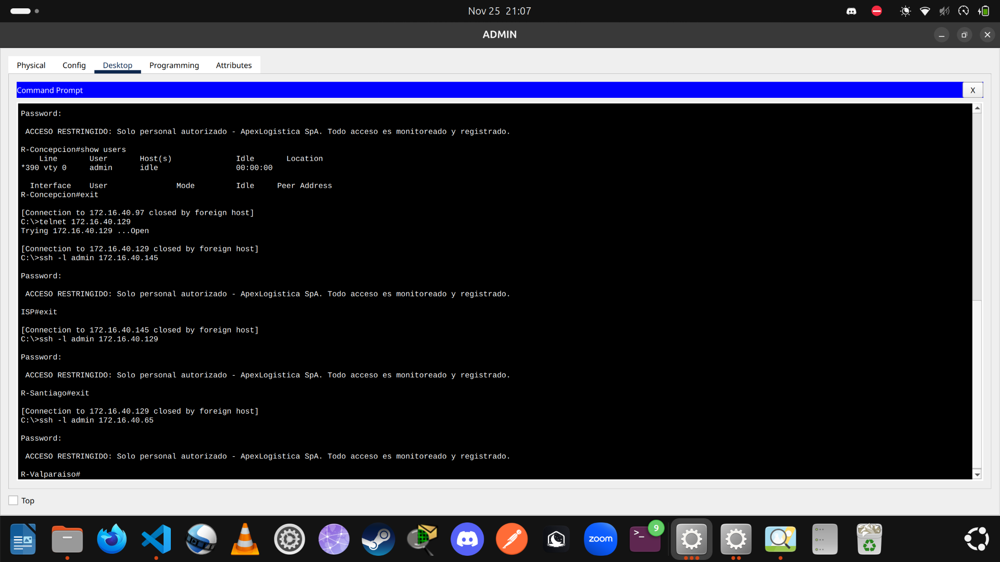

*Figura 24. ADMIN → R-Valparaiso (E6_05).*

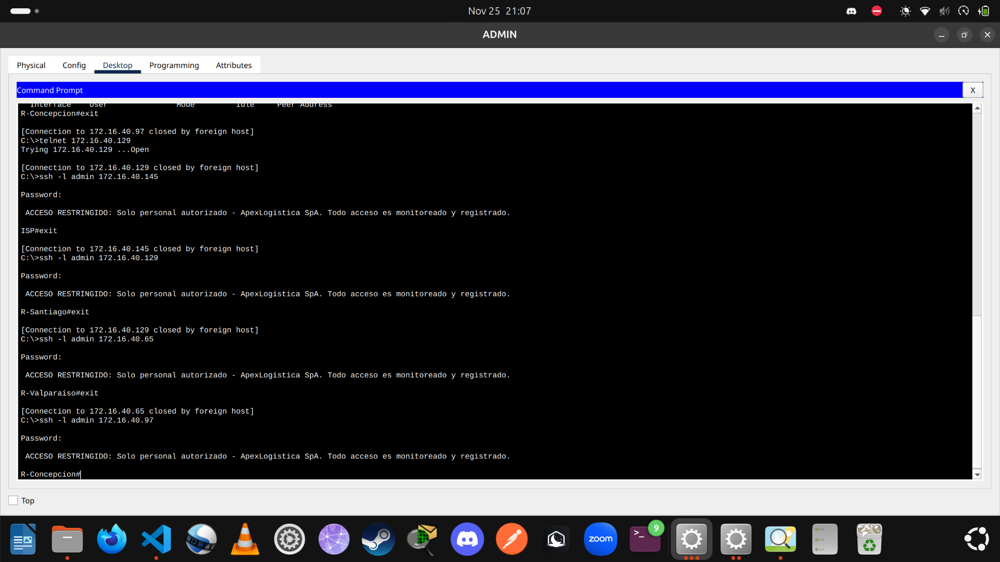

*Figura 25. ADMIN → R-Concepcion (E6_06): la PC de gestión administra los cuatro routers desde la red de servidores.*

Detalle: `E6_03_ssh_soporte_remoto.txt`.

### 8.3 Prueba de falla: caída del enlace ISP – R-Concepcion

Se ejecutó `shutdown` en R-Concepcion Gi0/0 para simular el corte del enlace WAN de la sede.

| Estado | Ruta por defecto de R-Concepcion | Vecinos OSPF | tracert 8.8.8.8 desde PC-Concepcion-1 |
|---|---|---|---|
| Antes | `S* [1/0] via 172.16.40.153` (ISP) | 2 (ISP y Valparaíso) | 2 saltos: .97 → 8.8.8.8 |
| Durante | `S* [210/0] via 172.16.40.161` (**flotante**) | 1 (Valparaíso) | 3 saltos: .97 → .161 → 8.8.8.8, 0 % pérdida |
| Después (`no shutdown`) | `S* [1/0] via 172.16.40.153` | 2 | 2 saltos |

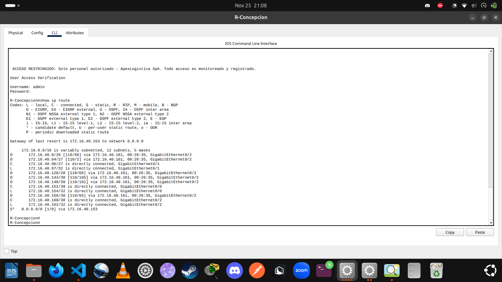

*Figura 26. ANTES (E6_07): la ruta por defecto activa es la principal, con AD 1, hacia el ISP.*

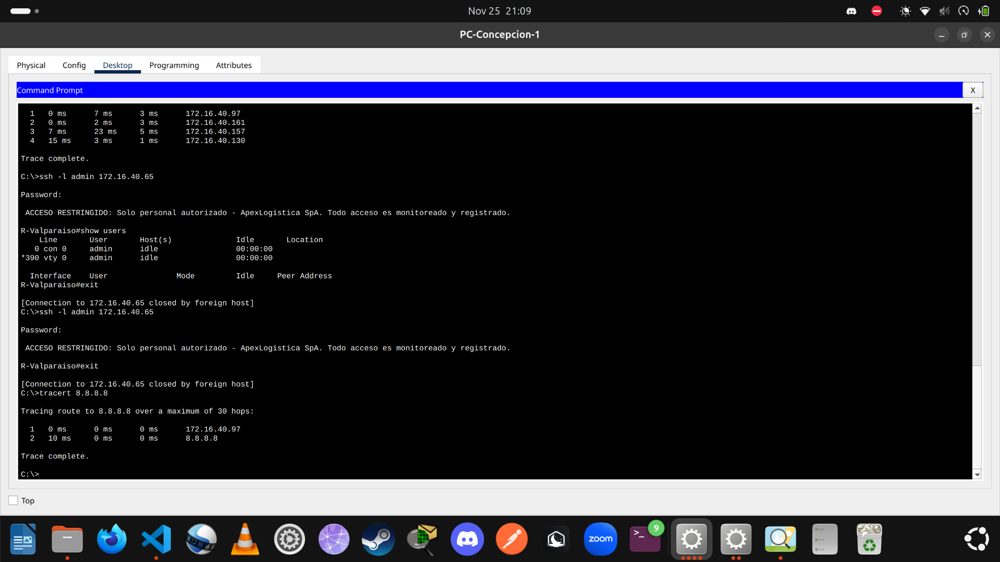

*Figura 27. ANTES (E6_08): Concepción llega a 8.8.8.8 en 2 saltos por su propio ISP.*

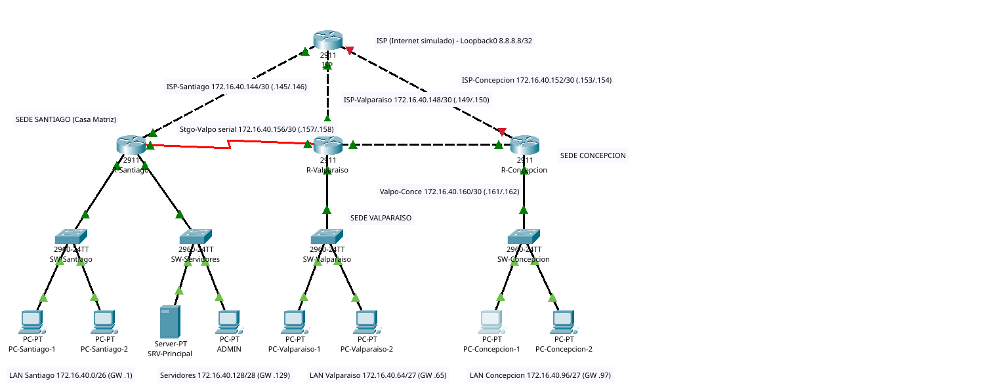

*Figura 28. DURANTE (E6_12): el enlace ISP–Concepción aparece en rojo y el resto de la red sigue operativo.*

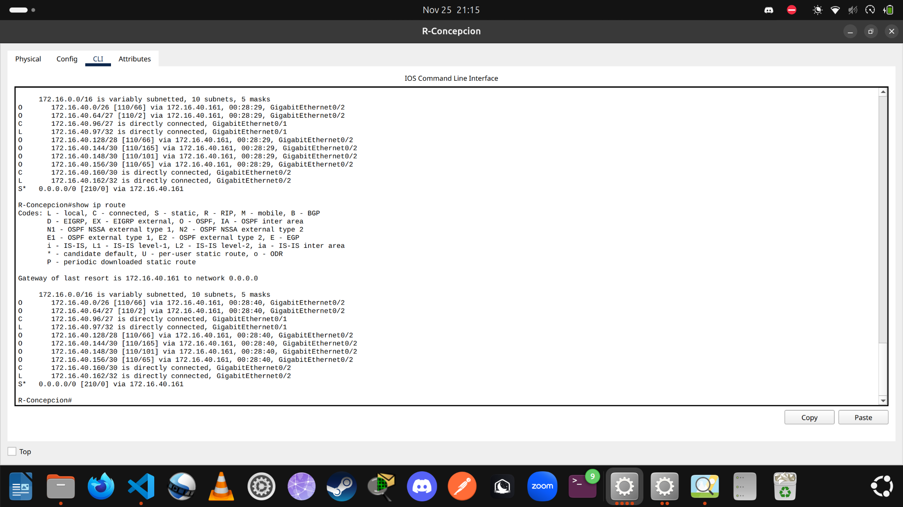

*Figura 29. DURANTE (E6_09): al perder el enlace, la ruta AD 1 deja de ser válida y se instala la flotante `S* [210/0] via 172.16.40.161` hacia Valparaíso.*

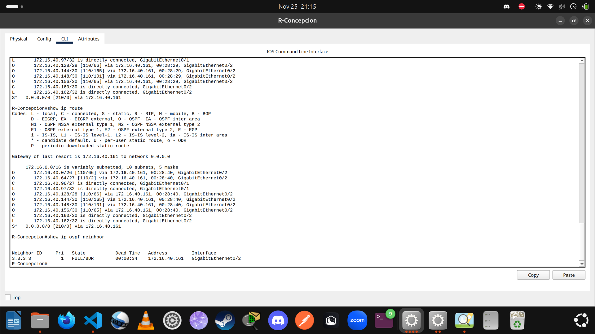

*Figura 30. DURANTE (E6_10): OSPF solo conserva el vecino 3.3.3.3 (Valparaíso). El ISP, por su parte, aprendió la LAN de Concepción a través de Valparaíso, con lo que el tráfico de retorno queda resuelto.*

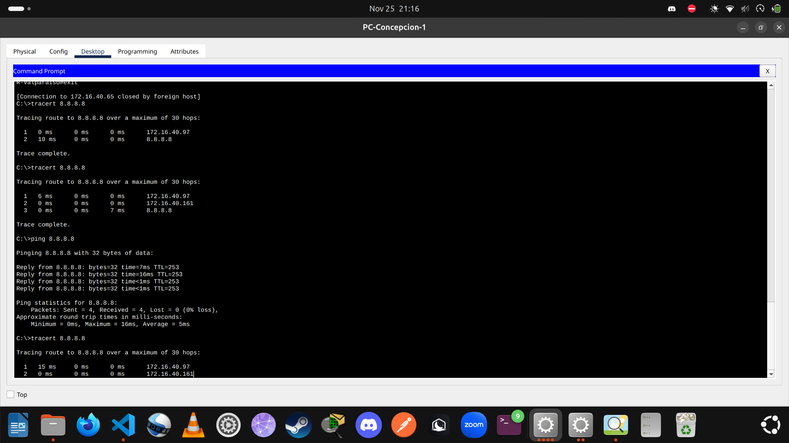

*Figura 31. DURANTE (E6_11): en la misma pantalla se ve el tracert de antes (2 saltos) y el de durante la falla (3 saltos, pasando por .161), con ping al 100 %.*

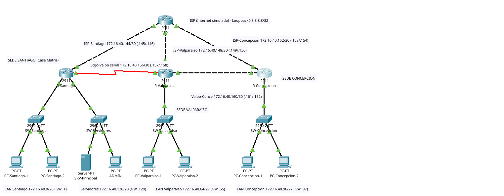

*Figura 32. DESPUÉS (E6_13): con el enlace restaurado, todos los enlaces vuelven a verde. La ruta principal AD 1 reemplaza a la flotante y OSPF vuelve a tener dos vecinos.*

Registro completo de la prueba: `E6_04_prueba_falla_enlace_ISP_Concepcion.txt`.

### 8.4 Plan de continuidad (resumen)

| Escenario | Impacto | Respuesta | RTO | RPO | Prevención |
|---|---|---|---|---|---|
| Caída de enlace WAN o inter-sucursal | Pérdida del camino primario | OSPF reconverge y se instala la ruta flotante AD 210 (automático) | ≈ 0–1 min | 0 | Caminos redundantes, rutas flotantes, resumen AD 250 en el ISP |
| Caída del Domain Controller | Sin inicio de sesión de dominio ni GPO | DC secundario o restauración de snapshot | 1 h (≈ 0 con DC secundario) | 24 h (≈ 0 con replicación) | DC secundario, snapshots diarios de VM |
| Caída del servidor web | Sin sitio web (y sin DNS si cae el equipo) | Servidor alternativo con el respaldo del sitio y actualización del DNS | 30 min | 24 h | Respaldo del sitio, DNS secundario |

El plan completo, con detección, acción inmediata, recuperación y responsables, está en `evidencias/plan_continuidad.md`.

---

## 9. Problemas encontrados y soluciones

| # | Problema | Causa | Solución |
|---|---|---|---|
| 1 | El 2911 trae solo 3 interfaces y R-Santiago/R-Valparaiso necesitan 4 | Límite del hardware | Tarjeta HWIC-2T y enlace serial Santiago–Valparaíso |
| 2 | Notas del canvas tapaban nombres de equipos | Posición de las notas | Reubicación de las notas y nueva captura |
| 3 | `show controllers … \| include` devolvió error | El IOS de PT no filtra esa salida | Salida completa: DCE en R-Santiago, DTE en R-Valparaiso |
| 4 | La configuración de seguridad no se aplicó en R-Concepcion | La consola estaba en modo usuario (`>`) | Repetir comenzando con `enable` y verificar el prompt |
| 5 | Canvas vacío al reabrir el proyecto | Dos instancias de PT abiertas | Abrir el `.pkt` en la instancia correcta y cerrar la otra sin guardar |
| 6 | Vecinos OSPF en 2WAY tras configurar | Elección DR/BDR y *wait timer* de 40 s en Ethernet | Esperar la convergencia: las 5 adyacencias quedan FULL |
| 7 | Primer `nslookup` desde Concepción sin respuesta | Resolución ARP inicial en el camino de 3 routers | Segunda consulta exitosa |
| 8 | No se podía crear `documentacion.html` de forma automatizada | La API de PT solo edita archivos existentes | Crear el archivo en Services > HTTP > New y cargar el contenido |
| 9 | Sesiones SSH anidadas durante una captura | Se ejecutó `ssh` desde el prompt del router en vez del PC | Cerrar con `exit` hasta `C:\>`; captura limpia repetida desde PC-Valparaiso-2 |
| 10 | `terminal length 0` no disponible | No implementado en el IOS de PT | Paginar con espacio y dejar la salida completa en texto |

Detalle: `evidencias/problemas.md`.

---

## 10. Análisis de resultados y conclusiones técnicas

### 10.1 Resultados obtenidos (datos medidos)

- **Direccionamiento:** 9 subredes VLSM sin solapamiento; uso del 16 % del bloque /22 con espacio contiguo para crecer.
- **Enrutamiento:** 5/5 adyacencias OSPF en FULL; tablas con rutas C, L, O y S\* en los cuatro routers. El costo OSPF ajustado hace que el tráfico entre sedes use los enlaces inter-sucursales (costo 66 frente a 201).
- **Conectividad:** 12/12 pruebas de ping con 0 % de pérdida y caminos de tracert coherentes con el diseño.
- **Seguridad:** SSHv2 operativo en 4/4 routers, 6/6 sesiones remotas exitosas y Telnet bloqueado.
- **Servicios:** DNS y web accesibles por nombre desde las 3 sedes.
- **Continuidad:** ante la caída del enlace WAN de Concepción, la conmutación a la ruta flotante y la reconvergencia OSPF fueron automáticas, sin pérdida de paquetes en las pruebas, y el estado original se recuperó al restaurar el enlace.

### 10.2 Análisis personal

[COMPLETAR POR EL ESTUDIANTE]

### 10.3 Conclusiones

[COMPLETAR POR EL ESTUDIANTE]

---

## 11. Referencias

Cisco Networking Academy. (s.f.). *CCNA: Enterprise networking, security, and automation* [Curso en línea]. Cisco Systems. https://www.netacad.com [VERIFICAR: edición/versión del curso cursado]

Cisco Systems. (s.f.). *IP routing: OSPF configuration guide* [Documentación de Cisco IOS]. https://www.cisco.com [VERIFICAR: URL exacta y versión de IOS]

Cisco Systems. (s.f.). *Security configuration guide: Secure Shell* [Documentación de Cisco IOS]. https://www.cisco.com [VERIFICAR: URL exacta y versión de IOS]

Fuller, V., & Li, T. (2006). *Classless inter-domain routing (CIDR): The Internet address assignment and aggregation plan* (RFC 4632). Internet Engineering Task Force. https://doi.org/10.17487/RFC4632

Mockapetris, P. (1987). *Domain names – Implementation and specification* (RFC 1035). Internet Engineering Task Force. https://doi.org/10.17487/RFC1035

Moy, J. (1998). *OSPF version 2* (RFC 2328). Internet Engineering Task Force. https://doi.org/10.17487/RFC2328

Rekhter, Y., Moskowitz, B., Karrenberg, D., de Groot, G. J., & Lear, E. (1996). *Address allocation for private internets* (RFC 1918). Internet Engineering Task Force. https://doi.org/10.17487/RFC1918

Ylonen, T., & Lonvick, C. (Ed.). (2006a). *The Secure Shell (SSH) protocol architecture* (RFC 4251). Internet Engineering Task Force. https://doi.org/10.17487/RFC4251

Ylonen, T., & Lonvick, C. (Ed.). (2006b). *The Secure Shell (SSH) transport layer protocol* (RFC 4253). Internet Engineering Task Force. https://doi.org/10.17487/RFC4253

*Referencias para la Parte 2 (agregar al completarla):* documentación oficial de Microsoft sobre Active Directory Domain Services y wiki oficial de Samba sobre Samba como controlador de dominio AD. [VERIFICAR: título, URL y fecha de consulta al momento de usarlas]
